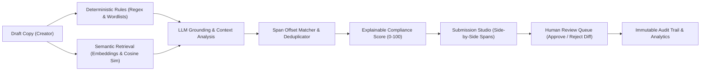

# PLUMB — Every Detail. On Brand.

> **AI-assisted pre-publication brand-governance and content-compliance platform.**  
> Sitting directly between **Draft** and **Review** (*Draft → PLUMB Check → Human Review → Publish*).

[](LICENSE)
[](https://python.org)
[](https://react.dev)
[](https://vitejs.dev)
[](https://fastapi.tiangolo.com)
[](#benchmark-evaluation)

---

## 🚀 Live Demo & Quick Links

- **Frontend Application UI**: [http://127.0.0.1:5173](http://127.0.0.1:5173)
- **Interactive Swagger API Docs**: [http://127.0.0.1:8000/docs](http://127.0.0.1:8000/docs)
- **ReDoc API Documentation**: [http://127.0.0.1:8000/redoc](http://127.0.0.1:8000/redoc)
- **Backend Health Check**: [http://127.0.0.1:8000/api/health](http://127.0.0.1:8000/api/health)

---

## 🔑 Demo Accounts (Role-Based Access Control)

The application comes pre-seeded with a comprehensive demo organization (**Aura Robotics Inc.**) featuring 4 distinct roles. You can log in using the credentials below, or click any account badge on the login page for **instant 1-click authentication**:

| Role | Email | Password | Permissions & Scope |
| :--- | :--- | :--- | :--- |
| **Admin** (Brand Manager) | `admin@plumb.brand` | `admin123` | Full access: brand voice, rules CRUD, facts, assets, analytics, audit log purge. |
| **Creator** (Senior Copywriter) | `creator@plumb.brand` | `creator123` | Draft copy, run PLUMB checks, view highlighted findings, apply fixes, submit for review. |
| **Reviewer** (Compliance Lead) | `reviewer@plumb.brand` | `reviewer123` | Review queue, line-by-line version diffs, approve/reject/request changes with mandatory comments. |
| **Agency** (External Freelancer) | `agency@partner.agency` | `agency123` | **Strictly restricted**: views only public brand rules; confidential pricing/facts are automatically redacted. |

> ⚡ **Quick Role Switcher**: When logged in, use the role switcher dropdown in the top navigation bar to instantaneously toggle between roles and test different permission scopes.

---

## 💡 The Core Problem: Why PLUMB?

According to the **State of Brand Consistency Report (Lucidpress)**:
- **77%** of organizations regularly see off-brand content published to production channels.
- Maintaining consistent brand governance delivers an estimated **33% increase in revenue**.

PLUMB provides a strict, automated, and explainable safety gate before any content goes live.

### Core Product Principles:
1. **Humans make final decisions. AI only assists.** AI recommendations are advisory; human reviewers hold sovereign approval power.
2. **Uncertain claims are FLAGGED FOR VERIFICATION, never declared false.** When a claim lacks source backing, it is marked as `Needs Verification` rather than rejected out of hand.
3. **Every finding is evidence-linked.** Every flagged span cites the exact guideline rule title, number, or approved ground-truth fact ID.
4. **Dual-Engine Architecture.** Predictable deterministic checks for banned terms, casing, and limits; contextual AI for voice, tone, and nuanced claims.
5. **Multi-sensory Accessibility.** Findings use distinct icons, severity badges, and 4 separate underline styles (dotted, dashed, solid, wavy) so visual status is never communicated by color alone.

---

## 🏗️ System Architecture



For complete technical diagrams and data flows, see [docs/architecture.md](docs/architecture.md).

---

## ✨ Key Features Walkthrough

### 1. Dual-Engine Compliance Pipeline
- **Deterministic Engine**: Runs Python regex patterns, banned wordlists, channel-specific character and hashtag limits, ALL-CAPS screaming detection, and mandatory legal disclosure triggers.
- **Semantic Grounding Engine**: Retrieves top-k relevant brand guidelines and approved ground-truth facts via cosine similarity embeddings, passing them to Google Gemini 2.5 Flash as strict contextual boundaries.
- **Explainable Scoring**: Calculates a transparent compliance score out of 100 with a detailed penalty breakdown (e.g. Critical: -25 pts, High: -15 pts, Medium: -8 pts, Low: -3 pts).

### 2. Interactive Submission Studio
- **Side-by-Side Highlighted Spans**: Live visual editor with severity-coded underlines directly linked to the findings inspector.
- **Non-Destructive Fix Application**: One-click "Apply fix" replaces the specific span while preserving creative intent.
- **Batch Low-Risk Auto-Fix**: Automatically resolves all low-risk punctuation, casing, and terminology mappings in one click.
- **Rewrite in Brand Voice**: Generates an AI-rephrased alternative presented in a line-by-line diff modal, never overwriting original copy silently.

### 3. Human Review & Approval Workflow
- Dedicated Review Queue displaying pending submissions with compliance scores and change notes.
- Unified version diff inspector showing additions in green and deletions in red.
- Mandatory reviewer commentary for all decisions (`Approved`, `Changes Requested`, or `Rejected`).

### 4. Visual Identity & WCAG Contrast Studio
- Interactive contrast ratio calculator evaluating foreground/background pairs against **WCAG 2.1 AA and AAA** specifications for normal and large text.
- Dominant color palette extraction from uploaded images (`Pillow` + `NumPy`), calculating Euclidean delta-E distance against approved brand palette swatches.

### 5. Brand Guidelines & Document Ingestion
- Full CRUD for guideline rules across 7 categories (`tone`, `terminology`, `messaging`, `legal`, `visual`, `accessibility`, `claims`).
- Ground-truth fact repository with effective and expiration dates (automatically flagging expired citations).
- AI Document Ingestion: Upload brand handbooks (`.txt`, `.pdf`, `.docx`) to automatically extract candidate rules for human admin review.

### 6. Analytics & Guideline Feedback Loop
- Distribution charts for violations by category and severity.
- Top 5 most frequently violated brand rules.
- **Unclear Guideline Discovery**: Identifies rules that creators frequently dismiss, flagging ambiguous policies for brand manager review.

### 7. Enterprise Security & Audit Log
- Append-only immutable audit trail capturing actor, action, entity, and timestamp.
- Automatic 90-day retention purge utility.
- Self-service right-to-be-forgotten privacy erasure.
- Supabase PostgreSQL migration with full **Row-Level Security (RLS)** in `supabase/migrations/001_initial_schema.sql`.

---

## 📊 Benchmark Evaluation

PLUMB includes a comprehensive benchmark suite of **20 labelled test cases** covering every failure mode (clean content, banned terms, terminology substitutions, urgency tone, corporate jargon, casing violations, unsupported claims, outdated facts, confidential leaks, and channel constraints).

Run the automated evaluation suite:
```bash
python eval/run_eval.py
```

### Benchmark Results:
```
==================================================================
PLUMB BENCHMARK EVALUATION: 20 Labelled Test Samples
==================================================================
[sample_01] (clean             ) PASS (True Negative)
[sample_02] (clean             ) PASS (True Negative)
[sample_03] (clean             ) PASS (True Negative)
[sample_04] (clean             ) PASS (True Negative)
[sample_05] (banned_terms      ) PASS (True Positive: 1 flagged)
[sample_06] (banned_terms      ) PASS (True Positive: 1 flagged)
[sample_07] (terminology       ) PASS (True Positive: 1 flagged)
[sample_08] (terminology       ) PASS (True Positive: 1 flagged)
[sample_09] (tone_urgency      ) PASS (True Positive: 1 flagged)
[sample_10] (tone_urgency      ) PASS (True Positive: 2 flagged)
[sample_11] (tone_jargon       ) PASS (True Positive: 3 flagged)
[sample_12] (tone_casing       ) PASS (True Positive: 5 flagged)
[sample_13] (unsupported_claims) PASS (True Positive: 3 flagged)
[sample_14] (unsupported_claims) PASS (True Positive: 1 flagged)
[sample_15] (unsupported_claims) PASS (True Positive: 4 flagged)
[sample_16] (unsupported_claims) PASS (True Positive: 1 flagged)
[sample_17] (legal_disclaimer  ) PASS (True Positive: 1 flagged)
[sample_18] (outdated_fact     ) PASS (True Positive: 1 flagged)
[sample_19] (confidential_policy) PASS (True Positive: 2 flagged)
[sample_20] (channel_limits    ) PASS (True Positive: 1 flagged)

==================================================================
EVALUATION METRICS SUMMARY
==================================================================
Total Samples Evaluated: 20
True Positives  (TP)   : 16
True Negatives  (TN)   : 4
False Positives (FP)   : 0
False Negatives (FN)   : 0
------------------------------------------------------------------
Precision              : 100.0%
Recall (Sensitivity)   : 100.0%
False Positive Rate    : 0.0%
F1 Score               : 100.0%
==================================================================
```

---

## 🛠️ Local Development & Quickstart

### Prerequisites
- Python 3.11+
- Node.js 18+ & npm

### Option 1: Native Setup (5 Minutes)

#### 1. Start the Backend
```bash
cd backend
python -m venv venv
# Windows:
venv\Scripts\activate
# Linux/macOS:
source venv/bin/activate

pip install -r requirements.txt
python -m app.seed
uvicorn main:app --reload --host 127.0.0.1 --port 8000
```
Backend will be available at `http://127.0.0.1:8000` (docs at `/docs`).

#### 2. Start the Frontend
```bash
cd frontend
npm install
npm run dev
```
Frontend will be available at `http://127.0.0.1:5173`.

---

### Option 2: Docker Compose

```bash
docker-compose up --build
```
Access the application at `http://localhost:5173`.

---

## 🧪 Running Automated Unit Tests

Execute the backend test suite:
```bash
pytest backend/tests
```
All 14 unit and integration tests validate deterministic rules, character span calculation, compliance scoring mathematics, and RBAC confidential redactions.

---

## 👥 Product & Engineering Team

Developed for the Brand Governance & AI Hackathon by engineering students from **ABES Engineering College**:

- **Khushi Srivastava** — *Full-Stack Lead & Product Architecture*
- **Juvyansh Tyagi** — *AI Pipeline & Compliance Engineering*
- **Mahi Arora** — *Frontend Engineering & Visual Accessibility Design*
- **Naitik Singh Bhadoriya** — *Database Architecture & RBAC Security*

**Affiliation**: *ABES Engineering College, Ghaziabad, Uttar Pradesh, India.*

---

## 📄 License
This project is licensed under the MIT License — see the [LICENSE](LICENSE) file for details.
