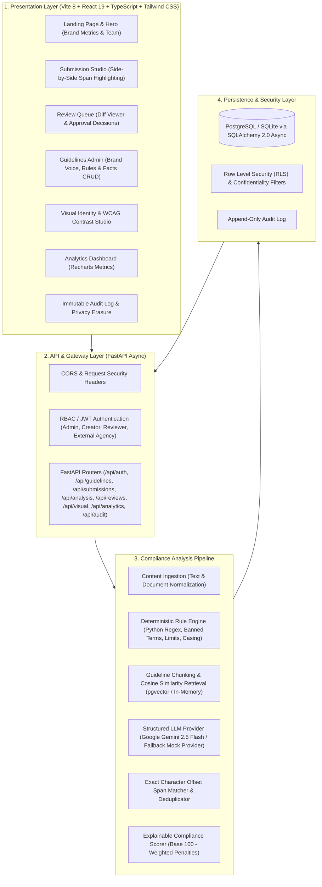

# PLUMB System Architecture

> **"Every Detail. On Brand."**  
> AI-assisted pre-publication brand-governance and content-compliance platform sitting directly between **Draft** and **Review** (*Draft → PLUMB Check → Human Review → Publish*).

---

## 1. High-Level Architectural Diagram



---

## 2. Layered Component Architecture

```
+-----------------------------------------------------------------------------------+
|                              1. PRESENTATION LAYER                                |
|  - React 19 + Vite 8 + TypeScript + Tailwind CSS v4                               |
|  - Black/Crimson Brand Design Tokens: #000000, #830000, #BC0202, #FF0000, #F5F5F5 |
|  - Multi-sensory Severity indicators (Icons + Text + Underline style variations)   |
|  - Non-destructive Suggestion Application & Unified Diff Inspector                |
+-----------------------------------------------------------------------------------+
                                         │
                                         ▼ HTTP / JSON / SSE
+-----------------------------------------------------------------------------------+
|                              2. BACKEND API & RBAC                                |
|  - FastAPI (Python 3.11+ / Python 3.14 async runtime)                            |
|  - Pydantic v2 validation models & OpenAPI schema generation                      |
|  - Role-based Access Control (Admin, Creator, Reviewer, External Agency)          |
|  - Confidentiality shielding (Hides internal pricing/facts from agencies)         |
+-----------------------------------------------------------------------------------+
                                         │
                                         ▼
+-----------------------------------------------------------------------------------+
|                        3. DUAL-ENGINE ANALYSIS PIPELINE                           |
|  ┌─────────────────────────────────────┐  ┌────────────────────────────────────┐  |
|  │      DETERMINISTIC RULE ENGINE      │  │     RETRIEVAL & AI GROUNDING       │  |
|  │ - Banned & forbidden words          │  │ - Guideline rule & fact chunking   │  |
|  │ - Preferred terminology mappings    │  │ - Cosine similarity top-k ranking  │  |
|  │ - Channel length & hashtag limits   │  │ - Google Gemini 2.5 Flash (JSON)   │  |
|  │ - ALL-CAPS screaming detection      │  │ - Fallback deterministic mock AI   │  |
|  │ - Mandatory legal disclaimers       │  │ - Strict Pydantic output parsing   │  |
|  │ - Superlatives & guarantee patterns │  │ - Unverified claim flag (not false)│  |
|  │ - Expired approved fact citations   │  │ - Rule & fact ID grounding cites   │  |
|  └─────────────────────────────────────┘  └────────────────────────────────────┘  |
|                                        │                                          |
|                                        ▼                                          |
|  ┌─────────────────────────────────────────────────────────────────────────────┐  |
|  │                      MERGE, DEDUPLICATION & SCORING                         │  |
|  │ - Exact server-side character offset alignment (span_start, span_end)       │  |
|  │ - Overlap deduplication prioritizing deterministic / higher severity        │  |
|  │ - Explainable scoring: Score = 100 - sum(Weights) * ChannelFactor           │  |
|  └─────────────────────────────────────────────────────────────────────────────┘  |
+-----------------------------------------------------------------------------------+
                                         │
                                         ▼
+-----------------------------------------------------------------------------------+
|                            4. DATA & PERSISTENCE LAYER                            |
|  - Primary DB: PostgreSQL + pgvector (Supabase production migration included)     |
|  - Local Demo DB: SQLite (plumb_demo.db) with SQLAlchemy async greenlet driver     |
|  - 14 Normalized Relational Tables + Immutable Audit Trail + Privacy Deletion     |
+-----------------------------------------------------------------------------------+
```

---

## 3. Data Flow: From Draft to Publication

1. **Creator Drafts Content**:
   - Submits copy (blog, social, email, ad, web) through the Studio or uploads `.txt` / `.docx`.
   - Optionally attaches visual assets (RGB images) for color palette and WCAG contrast analysis.
2. **Deterministic Rules First**:
   - Immediate scanning for absolute forbidden terminology, channel character/hashtag limits, screaming caps, and mandatory safety disclosures.
3. **Semantic Grounding Retrieval**:
   - Chunks active guidelines and facts, computes cosine similarity between submission text and guideline embeddings, and injects top-k citations into LLM prompt context.
4. **Contextual LLM Analysis**:
   - Evaluates tone, subtle bias, nuanced claims, and brand voice alignment.
   - Uncertain or unsupported claims are strictly flagged as **`needs_verification=True`** (never falsely marked false without evidence).
5. **Exact Span Mapping & Scoring**:
   - Backend matches string excerpts against original text to guarantee accurate character offsets `[span_start, span_end]`.
   - Calculates transparent compliance score with penalty breakdown.
6. **Creator Review & Refinement**:
   - Creator applies individual suggestions, executes batch low-risk auto-fixes, or requests an AI voice rewrite.
   - Every resubmission creates an incremented immutable `submission_version`.
7. **Human Compliance Review**:
   - Submissions route to the Review Queue.
   - Compliance officers review highlighted evidence, version diffs, and approve, reject, or request changes with mandatory feedback.
8. **Audit Trail & Continuous Analytics**:
   - All actions append to the immutable `audit_log`.
   - Aggregate metrics reveal top violated rules and frequently dismissed guidelines (highlighting ambiguous brand policies).

---

## 4. Security & Role-Based Access Control (RBAC)

| Role | Guidelines Access | Facts Access | Submission CRUD | Approval Power | Analytics & Audit |
| :--- | :--- | :--- | :--- | :--- | :--- |
| **Admin** | Read / Write All | Read / Write All | Read All | View All | Full Access + Purge |
| **Creator** | Read (Shared + Internal) | Read (Shared + Internal) | Create / Edit Own | Submit for Review | Own Metrics |
| **Reviewer** | Read All | Read All | Read All | Approve / Reject / Changes | Compliance Metrics |
| **Agency** | Read (**Shared Only**) | Read (**Shared Only**) | Create / Edit Own | Submit for Review | Restricted |

- **Confidential Document Isolation**: Rules or approved facts marked `is_confidential=True` are automatically redacted at both the SQL query level and API response serialisation for external users.
